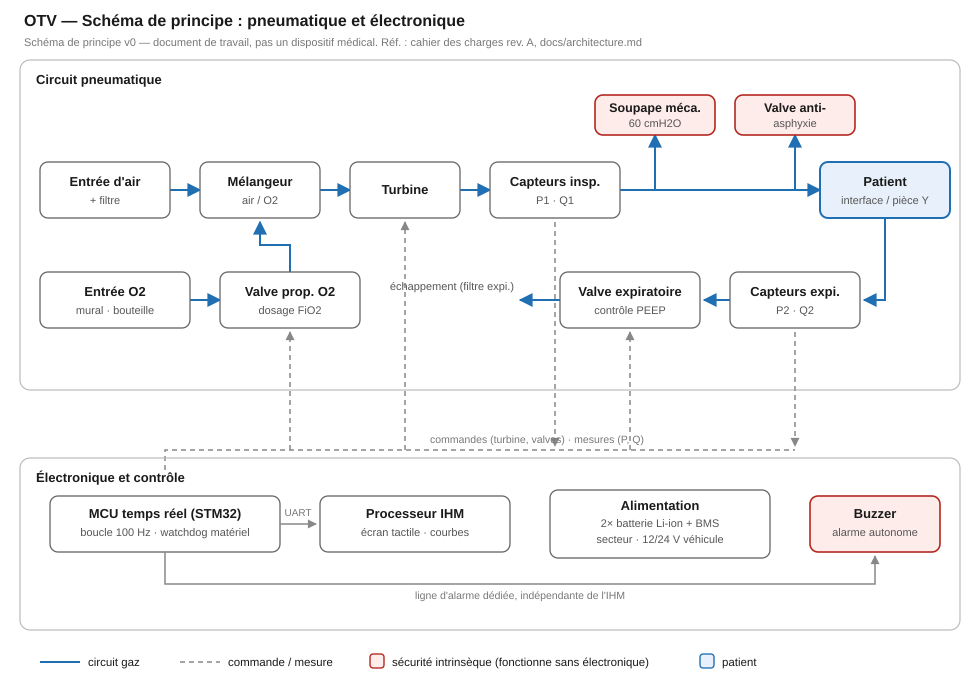

# Architecture système (v0)

Architecture à turbine asservie, deux étages électroniques (cf. étude de
l'existant et cahier des charges §7).

## Circuit pneumatique



```
Entrée d'air (filtre) ──► Turbine ──► Capteurs insp. (P, débit) ──► Patient
Entrée O2 (valve proportionnelle) ──► (mélange amont turbine)
Patient ──► Valve expiratoire (contrôle PEEP) ──► échappement
Sécurités mécaniques : soupape 60 cmH2O, valve anti-asphyxie
```

## Électronique et logiciel

| Étage | Rôle | Criticité |
| --- | --- | --- |
| MCU temps réel | Boucle pression/débit ≥ 100 Hz, machine d'états respiratoire, alarmes hautes, watchdog | IEC 62304 classe C |
| Processeur IHM | Écran, courbes, réglages, journal, export | Classe B visée (ségrégation à démontrer) |
| Alimentation | Batterie Li-ion + BMS, secteur, 12/24 V véhicule | — |

Le cœur temps réel est développé en C portable (`firmware/core/`), sans
allocation dynamique ni dépendance, pour être exécutable et testable sur hôte
(CI) comme sur cible. La cible matérielle (STM32 pressenti, héritage MakAir)
sera figée avec le choix de la turbine.

## Décisions ouvertes

- Turbine : référence à qualifier (−18 °C, endurance) — critère bloquant.
- Capteur de débit : différentiel sur diaphragme vs capteur massique.
- Cible MCU : STM32H7 vs STM32G4 ; un seul cœur de calcul + watchdog externe.
- Bus MCU ↔ IHM : UART + protocole télémétrie versionné (héritage concept MakAir).
